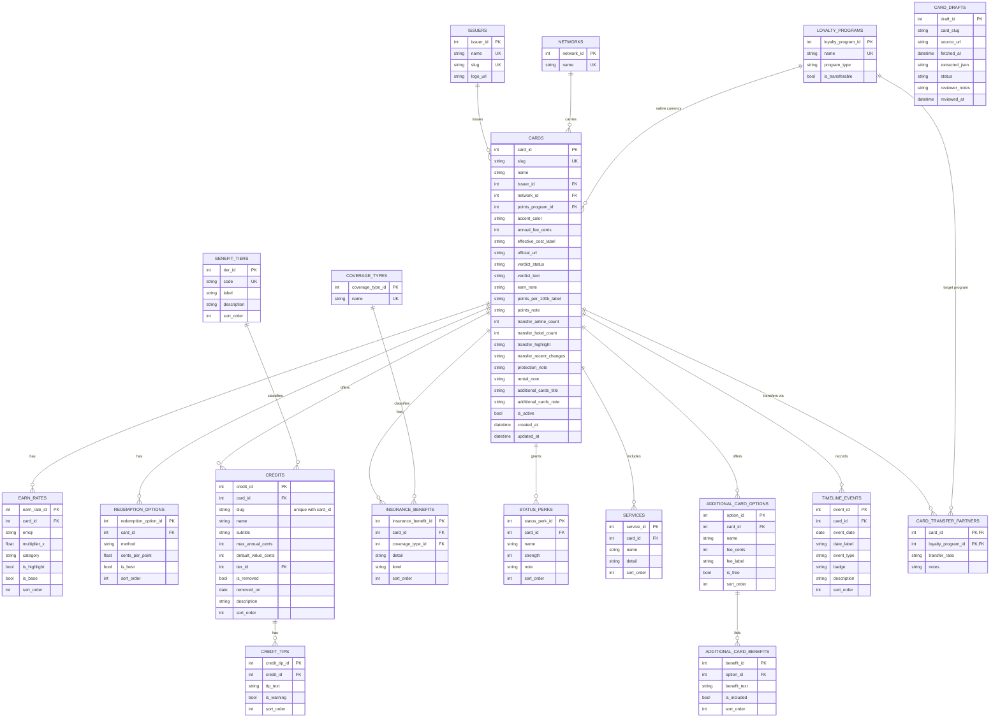

# Backend: card catalog database

The card catalog is a normalized relational schema (18 tables), not a single JSON
blob. This doc covers the schema shape, how data actually gets in, and how to add
or update a card.

## Why a database instead of one JSON file

`backend/data/cards.json` (a single ~750-line array) worked for four hand-written
cards, but doesn't scale: repeated strings with no integrity (issuer/network names
can drift between cards), no way to query across cards ("which cards have primary
rental coverage?"), one malformed brace breaks every card at once, and no path to
letting the catalog grow without a PR per edit.

## Schema

- **Reference/lookup tables** — `issuers`, `networks`, `loyalty_programs`,
  `benefit_tiers`, `coverage_types`. Shared across cards, get-or-created by name so
  "American Express" resolves to the same row for every card that uses it.
- **`cards`** — the core entity. One row per card.
- **Detail tables** — one per repeating block in the original data: `earn_rates`,
  `redemption_options`, `credits` (+ `credit_tips`), `insurance_benefits`,
  `status_perks`, `services`, `additional_card_options` (+ `_benefits`),
  `timeline_events`. Each has a `sort_order` column standing in for array position,
  and cascades on delete with its card.
- **`card_transfer_partners`** — junction table (card ↔ named transfer partner).
  Populated for the subset of cards where a reliable, verified per-partner
  source exists (name, type, ratio); the rest still only have the aggregate
  counts (`transfer_airline_count`/`transfer_hotel_count` on `cards`). Extend
  this as verified per-partner sources become available for other cards,
  rather than inventing entries.
- **`card_drafts`** — the review queue. Not part of the normalized schema itself;
  holds fetched-and-extracted card data pending human approval before it's promoted
  into the tables above.
- **`sessions` / `page_views`** — anonymous first-party analytics (no IP, no raw
  User-Agent; see the model docstrings for the PII stance). Written by
  `POST /api/events`, rate limited and length-capped.
- **`client_errors`** — frontend JavaScript errors, reported first-party by
  `POST /api/client-errors` instead of a third-party service (issue #149). Same
  PII stance and rate limiting as the analytics tables. To see what's breaking,
  in the Neon console (or any client):

  ```sql
  SELECT occurred_at, message, path, device_type
  FROM client_errors ORDER BY occurred_at DESC LIMIT 50;

  -- what's breaking most, grouped
  SELECT message, count(*), max(occurred_at) AS latest
  FROM client_errors GROUP BY message ORDER BY count(*) DESC;
  ```



`card_drafts` has no FK to `cards` on purpose — it's a staging area, not part of the
normalized graph above (see "How data gets in" below).

Design choices worth knowing before touching this schema:
- **Money is integer cents** (`annual_fee_cents`, not a float `annual_fee`) — no
  rounding drift. The API layer converts to whole dollars at the response boundary.
- **`is_removed`, not deleted.** A discontinued credit (e.g. Amex Platinum's old
  Saks credit) stays a row with `is_removed = true` — historical accuracy is a
  product feature (see the card detail page's timeline), not just data hygiene.
- **Every FK is indexed.** Postgres doesn't do this automatically, and it's easy to
  forget when adding a new detail table.

## How data gets in

```
backend/data/cards/staging/{slug}.json  →  drafts add  →  card_drafts (pending)
                                                          │
                                                    drafts promote
                                                          │
                                                          ▼
                                              upsert_card() [backend/scripts/upsert.py]
                                                          │
                                                          ▼
                                            normalized tables (cards, credits, ...)
                                                          │
                                                          ▼
                                move file: staging/{slug}.json → {issuer}/{slug}.json
```

`upsert_card()` is the single write path — both draft promotion and any future
direct re-sync go through it. It's idempotent: re-running it for an already-live
card updates the row and fully replaces its child collections (credits, earn
rates, etc.) rather than duplicating them.

## Adding or updating a card

1. Research the card from its official issuer page. Prefer the issuer's own site
   over third-party aggregators for factual claims (fees, credit amounts, terms) —
   editorial content like tips and the keep/reconsider verdict is necessarily a
   judgment call either way.
2. Write the card to `backend/data/cards/staging/{slug}.json`, matching the
   `Card` shape in `backend/models.py`. A file in `staging/` means "drafted,
   not yet promoted" — the seeding fixture in `tests/backend/conftest.py`
   skips this folder for exactly that reason, so a pending card never behaves
   like a live one in tests. See `backend/data/cards/staging/README.md`.
   For co-branded cards (a bank card tied to an airline/hotel loyalty program),
   the `id` follows `{issuer}-{brand}-{type}`, e.g. `amex-hilton-honors-aspire`
   or `amex-marriott-bonvoy-brilliant` — keeps cards from the same loyalty
   program grouped together alphabetically and makes the issuer unambiguous.
3. Add it to the review queue:
   ```bash
   uv run python -m backend.scripts.drafts add <slug> "<source url>" backend/data/cards/staging/<slug>.json
   ```
   This validates against the Pydantic schema before it's even allowed into the
   queue — a draft that doesn't parse never becomes something to review.
4. Review it: `uv run python -m backend.scripts.drafts show <draft_id>`
5. Promote it (or reject it with a reason):
   ```bash
   uv run python -m backend.scripts.drafts promote <draft_id> --notes "..."
   uv run python -m backend.scripts.drafts reject <draft_id> --notes "..."
   ```
   A rejected draft can't be promoted later — fix the JSON and add it as a new
   draft instead.
6. Once promoted, move the file out of staging into its issuer folder so the
   file tree matches what's actually live:
   ```bash
   git mv backend/data/cards/staging/<slug>.json backend/data/cards/<issuer>/<slug>.json
   ```
7. Add its verification file with null dates, and regenerate the ranking fixture.
   See [MCP server](#mcp-server). Authoring a card is not verifying it, so never
   copy another card's date. A test fails if the file is missing.

## MCP server

A public MCP endpoint for AI agents, at `POST https://mcp.thewalletaudit.com/mcp`,
by API key. It runs inside this API process. [ADR 0003](../docs/adr/0003-public-mcp-server.md)
has the design, and [docs/mcp-server.md](../docs/mcp-server.md) is what partners read.

**Keys.** Mint in a real terminal, because the command refuses to run without one:

```bash
uv run python -m backend.scripts.mcp_keys mint --label "partner eval" --contact "ops@example.com"
```

Store the key in a password manager. Append the printed record to the JSON array in
Render, Environment, `MCP_API_KEYS`, then save and deploy. Confirm the `mcp_started`
log line shows the new key count. To validate a value before saving it:
`uv run python -m backend.scripts.mcp_keys check < candidate.json`.

- **Revoke:** delete the record, then save and deploy.
- **Rotate:** add the new record, hand over the new key, then remove the old record.

**When a card's facts change.** Each file in `backend/data/refresh/` stores a hash of
the facts it verified, and CI fails when they differ. Either record the new check
(`evidence`, today's date, `facts_sha256`) or set `last_verified_ok_at` and
`verification` to null. Never update only the hash, because that claims a check nobody
did. Editorial fields such as `verdict` and credit `tips` are outside the hash.

**When ranking inputs or rules change.** Regenerate, then read the `expected.json`
diff, which shows how every ranking moved:

```bash
UPDATE_RANKING_FIXTURE=1 uv run pytest tests/backend/mcp_server/test_ranking_parity.py
(cd frontend && npx vitest run tests/utils/rankingParity.test.ts -u)
uv run pytest tests/backend/mcp_server/test_ranking_parity.py
```

**When the tool contract changes.** Run `UPDATE_MCP_SURFACE=1 uv run pytest -s
tests/backend/mcp_server/test_tool_surface.py`, bump `CONTRACT_VERSION`, and add the
printed digest to `PUBLISHED_SURFACES` in `backend/mcp_server/contract.py`. Additions
are minor. Removing, renaming, tightening or changing a meaning is major, and ships as
new tool names with the old ones kept for a 90-day deprecation window.

**Monitoring.** Keep-warm sends a keyless `POST /mcp` and expects 401. The `mcp-smoke`
workflow runs on demand with the `MCP_SMOKE_KEY` secret and records challenge headers on
all three hostnames. Logs are JSON lines: `mcp_started`, `mcp_disabled`, `mcp_request`
and `mcp_rejections`.

**Known limit.** Tool calls make no database queries, but the start command runs
migrations and the seed first, so a Neon outage stops MCP at its next boot.

**Never** run `drafts promote` against the production `DATABASE_URL`. The site would see
the write at once, the MCP snapshot would not until the next boot, and that boot's seed
would deactivate the card unless its file has been deployed.

## Migrations

```bash
# after changing backend/db_models.py
uv run alembic revision --autogenerate -m "description"
uv run alembic upgrade head
```

Autogenerated migrations for SQLite sometimes need a manual `server_default` added
for new `NOT NULL` columns (SQLite can't `ALTER TABLE ADD COLUMN NOT NULL` without
one to backfill existing rows) — check the generated file before applying.

## Known gaps

- `card_transfer_partners` still only has real per-partner data for a minority
  of cards (see Schema above) — extend as verified sources become available.
- User accounts aren't built. `useCreditUsage`'s per-card credit-usage values
  persist in the browser's `localStorage` (survives a refresh), but aren't
  tied to an account, so they don't follow a user across devices/browsers.
